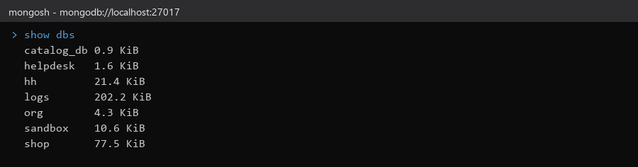
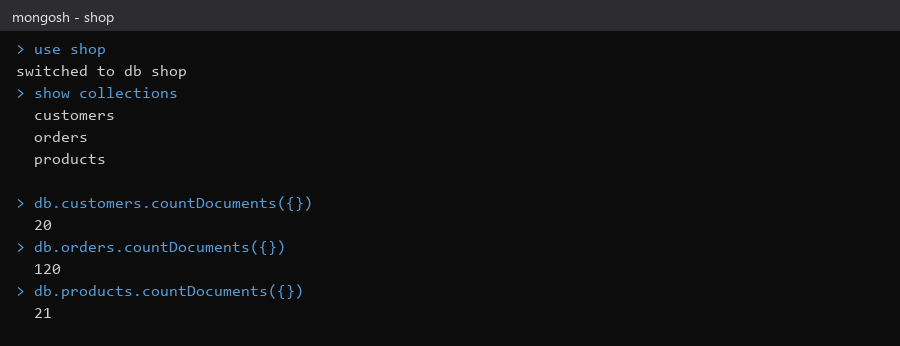
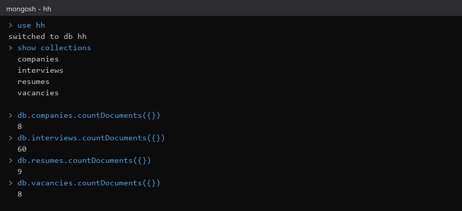
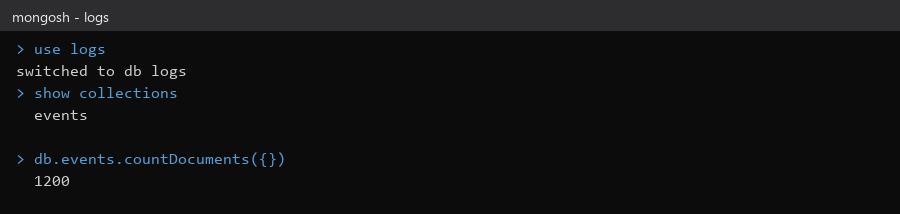
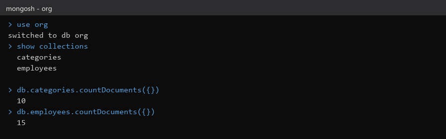

# Домашнее задание № 2 · Глава 1 справочника, базы и коллекции

**ФИО:** Сухинин Андрей Владимирович  
**Группа:** РПО/9/4  
**Тема:** «MongoDB: базы данных, коллекции и документы»

## Что сделано

1. Прочитана глава 1 справочника (параграфы 1.1–1.8): документ, BSON, коллекция, база.
2. Стенд поднимается командами `docker compose up -d` и `bash load.sh` из папки `stend`.
3. Compass подключается по адресу `mongodb://localhost:27017`.

## Таблица: базы и коллекции

Числа взяты из seed-файлов стенда (`stend/seed`, `practice/.../stend/seed`) и совпадают с тем, что `load.sh` загружает в MongoDB.

| База | Ожидалось | Что в базе |
|---|---|---|
| `shop` | products 21 · orders 120 · customers 20 | products 21 · orders 120 · customers 20 |
| `hh` | resumes 9 · vacancies 8 · companies 8 · interviews 60 | resumes 9 · vacancies 8 · companies 8 · interviews 60 |
| `logs` | events 1200 | events 1200 |
| `org` | employees 15 · categories 10 | employees 15 · categories 10 |

Если в Compass числа не совпадают, выполните `docker compose down -v`, затем `docker compose up -d` и `bash load.sh`.

## Скриншоты

Вывод консоли `mongosh` по реальной базе в Docker (MongoDB 7), снимки делает [make_screens.py](make_screens.py).







## Сдача

```bash
git checkout -b hw-02
git add lesson_02
git commit -m "hw-02: базы и коллекции"
git push -u origin hw-02
```

Затем откройте Pull Request `hw-02` → `main` на GitHub.
