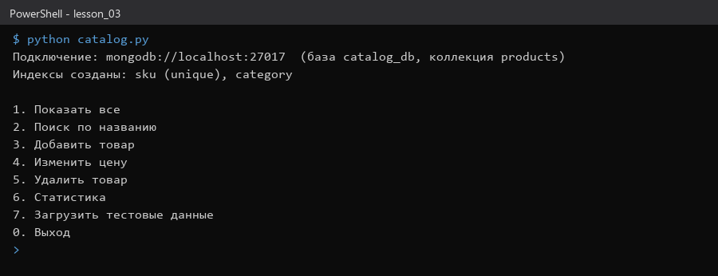
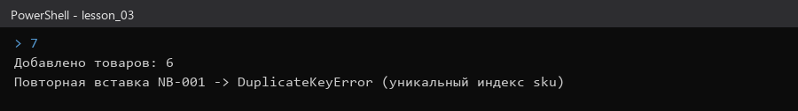
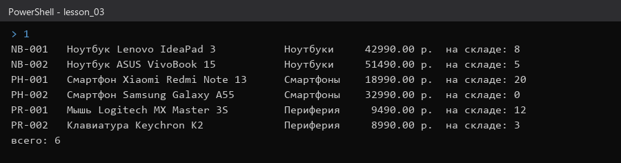
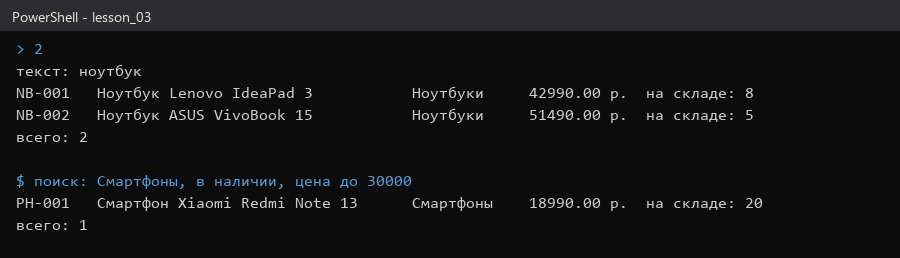
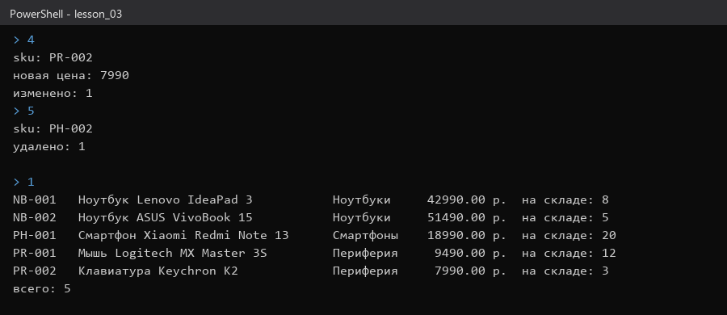
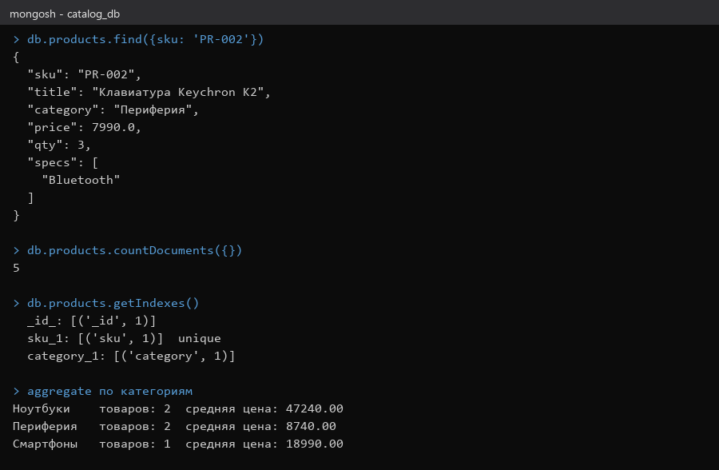

# Домашнее задание № 3 · Каталог товаров

**ФИО:** Сухинин Андрей Владимирович  
**Группа:** РПО/9/4  
**Тема:** «Каталог товаров интернет-магазина электроники на MongoDB»  
**Язык:** Python 3.12, библиотека `pymongo`  
**Файл:** [catalog.py](catalog.py)

## Что умеет программа

| Операция | Функция | Оператор MongoDB |
|---|---|---|
| Добавление товара | `create` | `insert_one` |
| Просмотр каталога | `show` | `find` + `sort` |
| Поиск (название, категория, цена, наличие) | `search` | `$regex`, `$gte`, `$lte`, `$gt` |
| Изменение цены | `update_price` | `$set` |
| Пополнение склада | `add_stock` | `$inc` |
| Удаление | `delete` | `delete_one` |
| Статистика по категориям | `stats` | `aggregate` с `$group` |

База: `catalog_db`, коллекция `products`. Уникальный индекс по `sku` защищает от дубликатов, индекс по `category` ускоряет фильтр.

Документ товара:

```json
{
  "sku": "NB-001",
  "title": "Ноутбук Lenovo IdeaPad 3",
  "category": "Ноутбуки",
  "price": 42990.0,
  "qty": 8,
  "specs": ["15.6\"", "8 ГБ"],
  "created": "ISODate(...)"
}
```

## Как запустить

```bash
cd stend
docker compose up -d
cd ../lesson_03
pip install pymongo
python catalog.py          # интерактивное меню
python catalog.py --demo   # автоматический сценарий
```

Compass: `mongodb://localhost:27017`, база `catalog_db`.

## Результат демо-сценария

Сценарий выполнен на MongoDB 7 в Docker (`mongodb://localhost:27017`).

- Загружено 6 товаров.
- Поиск «ноутбук» нашёл 2 товара.
- Смартфоны в наличии до 30 000 р.: найден 1 (Xiaomi Redmi Note 13).
- Цена клавиатуры Keychron K2 снижена до 7990, склад мыши Logitech пополнен на 10 (стало 22).
- Удалён Samsung Galaxy A55 (его не было в наличии).
- Итог: 5 товаров. Средняя цена по категориям: ноутбуки 47 240, периферия 8 740, смартфоны 18 990.

## Скриншоты

Скриншоты — вывод `catalog.py`, запущенного на MongoDB 7 (Docker). Снимки делает скрипт [make_screens.py](make_screens.py).

1. Запуск: 
2. Создание товаров: 
3. Каталог: 
4. Поиск: 
5. Обновление и удаление: 
6. Проверка в базе: 

## Ответы на вопросы

1. **Почему товар хранится одним документом, а не несколькими таблицами?**
   Характеристики у товаров разные (`specs` — массив произвольной длины). В MongoDB они лежат внутри документа, и для карточки товара не нужны соединения.
2. **Зачем уникальный индекс по `sku`?**
   Артикул идентифицирует товар. Индекс не даёт создать дубль: при повторной вставке будет `DuplicateKeyError`, а программа его обработает.
3. **Чем `$set` отличается от `$inc`?**
   `$set` записывает конкретное значение (новая цена), `$inc` меняет число на указанную величину (пополнение склада) и делает это атомарно, без чтения перед записью.

## Вывод

В работе написано консольное приложение на Python для каталога товаров. Оно реализует создание, поиск, обновление, удаление и статистику. В MongoDB данные лежат в коллекции `products` базы `catalog_db` с индексами по `sku` и `category`.
